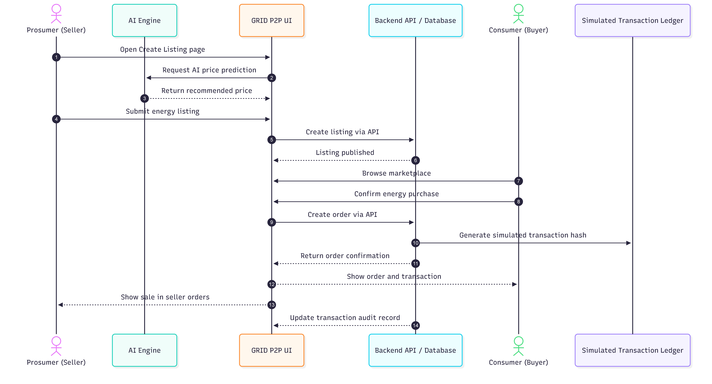
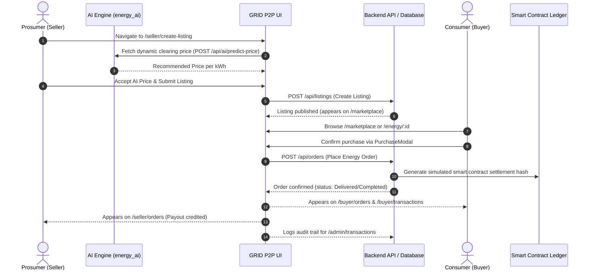

# GRID P2P — Complete Website Sitemap & System Navigation Architecture

> **Project Title:** GRID P2P — AI/ML Powered Decentralized Peer-to-Peer Energy Trading Marketplace  
> **Documentation Type:** Mini-Project Website Sitemap & Route Hierarchy  
> **Status:** Verified against Active Codebase (Frontend, Backend & AI Services)

---

## 1. Project Overview & Route Architecture

GRID P2P is a role-based, decentralized energy trading platform where **Clean Energy Prosumers (Sellers)**, **Consumers (Buyers)**, and **Grid Operators (Admins)** interact in an open, localized energy marketplace.

The application is structured into four primary navigational zones:
1. **Public Zone:** Open access for prospective users to browse the landing page, explore live energy listings, and inspect generator technical details.
2. **Authentication Gateway:** Role-based authentication (`Buyer`, `Seller`, `Admin`) enforcing protected routing via `ProtectedRoute` and JWT state management.
3. **Role-Specific Protected Portals:**
   - **Seller / Prosumer Portal (`/seller/*`):** Telemetry dashboard, surplus energy listing creation with AI price recommendation, active listings management, and fulfilled sales history.
   - **Buyer / Consumer Portal (`/buyer/*`):** Consumption dashboard, order management, smart contract transaction audit trail, and instant energy purchase.
   - **Admin / Grid Controller Portal (`/admin/*`):** Macro grid telemetry, node operator management, universal listing supervision, and ledger monitoring.
4. **Common Authenticated Services:** User profile configuration, node wallet identification, and real-time socket-driven grid notifications.

---

## 2. Master Route Table & Implementation Status

| Route Path | Page / Module Name | Layout Used | Access Level | Implemented Status | Key Components & Features |
|---|---|---|---|---|---|
| `/` | Landing Page | Clean (No Shell) | Public | **Implemented** | 3D Three.js Energy Grid, Typewriter Hero, Protocol Stats, Live Tickers, CTAs |
| `/marketplace` | Peer-to-Peer Marketplace | Clean + Navbar | Public | **Implemented** | Energy source filtering (Solar/Wind/Hydro/Biomass), search bar, live listing cards, purchase trigger |
| `/energy/:id` | Energy Listing Details | Clean + Navbar | Public | **Implemented** | Source specifications, grid reliability score, carbon offset metric, instant buy action |
| `/login` | User Login | `AuthLayout` | Public (Unauthenticated) | **Implemented** | Role-based credentials login, demo quick-fill presets for Buyer/Seller/Admin |
| `/register` | User Registration | `AuthLayout` | Public (Unauthenticated) | **Implemented** | Prosumer vs Consumer role picker, registration form, validation |
| `/seller` | Seller Redirect | — | Protected (`seller`, `admin`) | **Implemented** | Automatic redirection to `/seller/dashboard` |
| `/seller/dashboard` | Prosumer Overview | `DashboardLayout` | Protected (`seller`, `admin`) | **Implemented** | Solar generation stats, revenue metrics, generation charts, embedded AI pricing widget |
| `/seller/create-listing` | Create Energy Listing | `DashboardLayout` | Protected (`seller`, `admin`) | **Implemented** | Energy source selection, kWh volume, duration, live AI Smart Pricing Recommendation |
| `/seller/listings` | My Energy Listings | `DashboardLayout` | Protected (`seller`, `admin`) | **Implemented** | Seller active listings management, deletion/cancellation actions |
| `/seller/orders` | Energy Sales & Orders | `DashboardLayout` | Protected (`seller`, `admin`) | **Implemented** | Real-time sales log, buyer node IDs, delivery status, payout records |
| `/buyer` | Buyer Redirect | — | Protected (`buyer`, `admin`) | **Implemented** | Automatic redirection to `/buyer/dashboard` |
| `/buyer/dashboard` | Consumer Overview | `DashboardLayout` | Protected (`buyer`, `admin`) | **Implemented** | Green energy usage stats, carbon offset counters, hourly usage chart, peak demand forecast chart |
| `/buyer/orders` | My Energy Orders | `DashboardLayout` | Protected (`buyer`, `admin`) | **Implemented** | Purchased energy batches, producer information, fulfillment status |
| `/buyer/transactions` | Settlement & Ledger | `DashboardLayout` | Protected (`buyer`, `admin`) | **Implemented** | Simulated smart contract transaction hashes, escrow status, settlement timestamps |
| `/admin` | Admin Redirect | — | Protected (`admin`) | **Implemented** | Automatic redirection to `/admin/dashboard` |
| `/admin/dashboard` | Grid Telemetry & Overview | `AdminLayout` | Protected (`admin`) | **Implemented** | Substation node metrics, total MWh grid flow, power distribution charts, dynamic clearing tariff chart |
| `/admin/users` | Grid Participants | `AdminLayout` | Protected (`admin`) | **Implemented** | Prosumer & consumer registry, smart meter IDs, wallet addresses, node status |
| `/admin/listings` | Universal Listings Supervision | `AdminLayout` | Protected (`admin`) | **Implemented** | Complete cross-zone listing inventory, active/pending/fulfilled states |
| `/admin/transactions` | System Ledger & Auditing | `AdminLayout` | Protected (`admin`) | **Implemented** | Master transaction log, smart contract hashes, cryptographic audit trail |
| `/profile` | Account & Node Profile | `DashboardLayout` | Protected (All authenticated) | **Implemented** | Identity management, substation cluster node assignment, wallet address display |
| `/notifications` | Notifications & Grid Alerts | `DashboardLayout` | Protected (All authenticated) | **Implemented** | Real-time pricing surge alerts, smart contract settlement confirmations, order updates |
| `*` | 404 Not Found | Clean Shell | Public | **Implemented** | Error fallback page with navigation back to Home |

---

## 3. Complete Hierarchical Sitemap Diagram

The following Mermaid diagram illustrates the complete page hierarchy, user navigation flow, authentication checkpoints, and AI/ML model connections.

```mermaid
flowchart TD
    %% Global Styling
    classDef platform fill:#064e3b,stroke:#10b981,stroke-width:3px,color:#ffffff,font-weight:bold;
    classDef publicRoute fill:#0f172a,stroke:#38bdf8,stroke-width:2px,color:#f8fafc;
    classDef authRoute fill:#1e1b4b,stroke:#818cf8,stroke-width:2px,color:#f8fafc;
    classDef guard fill:#450a0a,stroke:#ef4444,stroke-width:2px,color:#fecaca,stroke-dasharray: 4 2;
    classDef sellerRoute fill:#14532d,stroke:#22c55e,stroke-width:2px,color:#f0fdf4;
    classDef buyerRoute fill:#164e63,stroke:#06b6d4,stroke-width:2px,color:#ecfeff;
    classDef adminRoute fill:#3b0764,stroke:#a855f7,stroke-width:2px,color:#faf5ff;
    classDef commonRoute fill:#334155,stroke:#94a3b8,stroke-width:2px,color:#ffffff;
    classDef aiModule fill:#78350f,stroke:#f59e0b,stroke-width:2px,color:#fffbeb;
    classDef plannedModule fill:#1e293b,stroke:#64748b,stroke-width:1.5px,color:#94a3b8,stroke-dasharray: 5 5;

    %% Root
    ROOT["⚡ GRID P2P PLATFORM<br/>(AI/ML Decentralized Energy Trading)"]:::platform

    %% Level 1: Public Entry & Auth
    ROOT --> PUB_PAGES["🌐 Public Navigation Zone"]:::publicRoute
    ROOT --> AUTH_GATE["🔐 Authentication Gateway"]:::authRoute
    ROOT --> ERR_PAGE["⚠️ 404 Not Found Page<br/><code>/*</code>"]:::publicRoute

    %% Public Pages Branch
    subgraph SUB_PUBLIC["Public Access Pages (No Login Required)"]
        PUB_PAGES --> LANDING["🏠 Landing Page<br/><code>/</code><br/>• 3D Energy Grid (Three.js)<br/>• Hero & Live Tickers<br/>• Value Proposition"]:::publicRoute
        PUB_PAGES --> MARKETPLACE["🛒 Energy Marketplace<br/><code>/marketplace</code><br/>• Real-Time Energy Feed<br/>• Solar/Wind/Hydro Filters<br/>• Price/kWh Sorting"]:::publicRoute
        MARKETPLACE --> ENERGY_DETAILS["📄 Energy Listing Details<br/><code>/energy/:id</code><br/>• Technical Specs & Location<br/>• Reliability & CO₂ Offset<br/>• Instant Purchase Modal"]:::publicRoute
    end

    %% Auth Branch
    subgraph SUB_AUTH["Authentication Gateway"]
        AUTH_GATE --> LOGIN["🔑 Login Page<br/><code>/login</code><br/>(Buyer / Seller / Admin Presets)"]:::authRoute
        AUTH_GATE --> REGISTER["📝 Register Page<br/><code>/register</code><br/>(Role Selection: Prosumer / Consumer)"]:::authRoute
        LOGIN --> AUTH_CHECK{"🛡️ ProtectedRoute<br/>Role & Token Guard"}:::guard
        REGISTER --> AUTH_CHECK
    end

    %% Role-Based Routing
    AUTH_CHECK -- "Role = Seller / Admin" --> SELLER_ZONE["⚡ Prosumer / Seller Portal<br/><code>/seller/*</code>"]:::sellerRoute
    AUTH_CHECK -- "Role = Buyer / Admin" --> BUYER_ZONE["🔋 Consumer / Buyer Portal<br/><code>/buyer/*</code>"]:::buyerRoute
    AUTH_CHECK -- "Role = Admin" --> ADMIN_ZONE["🛡️ Grid Controller / Admin Portal<br/><code>/admin/*</code>"]:::adminRoute
    AUTH_CHECK -- "Any Authenticated Role" --> COMMON_ZONE["⚙️ Account & Shared Services"]:::commonRoute

    %% Seller Portal Subgraph
    subgraph SUB_SELLER["Seller / Prosumer Module (/seller)"]
        SELLER_ZONE --> S_DASH["📊 Seller Dashboard<br/><code>/seller/dashboard</code><br/>• Generation & Revenue Stats<br/>• Generation vs Feed-in Chart"]:::sellerRoute
        SELLER_ZONE --> S_CREATE["➕ Create Energy Listing<br/><code>/seller/create-listing</code><br/>• Source Type, kWh, Price, Duration"]:::sellerRoute
        SELLER_ZONE --> S_LISTINGS["📋 My Listings<br/><code>/seller/listings</code><br/>• Manage & Cancel Active Offers"]:::sellerRoute
        SELLER_ZONE --> S_ORDERS["🧾 Energy Sales & Orders<br/><code>/seller/orders</code><br/>• Fulfilled Orders & Payouts"]:::sellerRoute
    end

    %% Buyer Portal Subgraph
    subgraph SUB_BUYER["Buyer / Consumer Module (/buyer)"]
        BUYER_ZONE --> B_DASH["📈 Buyer Dashboard<br/><code>/buyer/dashboard</code><br/>• Usage Stats & Carbon Offset<br/>• Hourly Usage Chart<br/>• Peak Demand Forecast"]:::buyerRoute
        BUYER_ZONE --> B_ORDERS["📦 My Energy Orders<br/><code>/buyer/orders</code><br/>• Purchased kWh, Delivery Status"]:::buyerRoute
        BUYER_ZONE --> B_TX["🔗 Settlement & Transactions<br/><code>/buyer/transactions</code><br/>• Smart Contract Tx Hashes<br/>• Escrow Status"]:::buyerRoute
        BUYER_ZONE -.->|"Browse & Buy"| MARKETPLACE
        ENERGY_DETAILS -.->|"Creates Order"| B_ORDERS
    end

    %% Admin Portal Subgraph
    subgraph SUB_ADMIN["Admin / Grid Controller Module (/admin)"]
        ADMIN_ZONE --> A_DASH["📡 Grid Telemetry Overview<br/><code>/admin/dashboard</code><br/>• 48 Active Microgrid Nodes<br/>• Power Distribution & Tariff Charts"]:::adminRoute
        ADMIN_ZONE --> A_USERS["👥 Prosumers & Buyers Management<br/><code>/admin/users</code><br/>• Node IDs & Wallet Registry"]:::adminRoute
        ADMIN_ZONE --> A_LISTINGS["📑 Universal Listings Inventory<br/><code>/admin/listings</code><br/>• Cross-zone Energy Offer Supervision"]:::adminRoute
        ADMIN_ZONE --> A_TX["⚖️ Master Ledger & Audit<br/><code>/admin/transactions</code><br/>• Global Smart Contract Logs"]:::adminRoute
    end

    %% Common Authenticated Services Subgraph
    subgraph SUB_COMMON["Shared Authenticated Services"]
        COMMON_ZONE --> PROFILE["👤 User Profile<br/><code>/profile</code><br/>• Substation Zone & Wallet Address"]:::commonRoute
        COMMON_ZONE --> NOTIFS["🔔 Notifications & Alerts<br/><code>/notifications</code><br/>• Real-time Socket & Price Surge Alerts"]:::commonRoute
    end

    %% AI / ML Service Connection
    subgraph SUB_AI["AI / Machine Learning Service (energy_ai & backend/routes/ai)"]
        AI_PRICE["🤖 Dynamic Price Recommendation<br/><code>POST /api/ai/predict-price</code><br/><code>GET /api/ai/price-recommendation</code>"]:::aiModule
        AI_DEMAND["📊 Demand Forecasting Model<br/><code>POST /api/ai/predict-demand</code>"]:::aiModule
        AI_GEN["☀️ Solar Generation Forecast<br/><code>POST /api/ai/predict-generation</code>"]:::aiModule
    end

    %% AI Connectors to Frontend
    AI_PRICE ==>|"Feeds Live AI Pricing"| S_CREATE
    AI_PRICE ==>|"Optimal Clearing Rate"| S_DASH
    AI_DEMAND -.->|"Demand Curve Chart"| B_DASH
    AI_GEN -.->|"Solar Generation Forecast"| S_DASH

    %% Planned Modules Subgraph
    subgraph SUB_PLANNED["Planned / Future Scope (Not Standalone in Frontend UI)"]
        P_AI_STUDIO["🔬 Dedicated AI Training/Forecast Studio<br/><code>/ai/forecast-studio</code> (Planned)"]:::plannedModule
        P_WEB3["🦊 Dedicated Web3 Wallet Signer<br/><code>/wallet/connect</code> (Planned MetaMask Hook)"]:::plannedModule
        P_IOT["📟 IoT Smart Meter Hardware Gateway<br/>(Direct MQTT / RS485 Stream - Planned)"]:::plannedModule
    end

    ROOT -.->|"Planned Future Route"| P_AI_STUDIO
    PROFILE -.->|"Planned Integration"| P_WEB3
    B_DASH -.->|"Hardware Telemetry"| P_IOT
```

---

## 4. End-to-End Operational Lifecycle Flows

### 4.1 Energy Listing to Settlement Flow

### 4.2 AI/ML Integration Model
* **Price Recommendation Engine:** Integrated via `components/seller/PriceRecommendation.jsx`. It queries `backend/src/routes/ai.routes.js` and `energy_ai/api/main.py` using market demand index, energy source type, and historical rates.
* **Demand Prediction Engine:** Rendered as predictive visual curves via `components/dashboard/DemandChart.jsx` in the Buyer and Admin Dashboards.
* **Solar Generation Forecast:** Rendered via `components/dashboard/EnergyChart.jsx` in the Seller Overview to contrast predicted generation vs actual grid feed-in.

---

## 5. Implemented vs Planned Module Matrix

| Module / Page | Status | Description in Existing Codebase |
|---|---|---|
| **Public Landing Page** (`/`) | ✅ **Implemented** | Full interactive landing with Three.js 3D energy particles, live protocol ticker, and responsive theme switcher. |
| **Marketplace** (`/marketplace`) | ✅ **Implemented** | Live queryable energy market with source category filters and search. |
| **Energy Details** (`/energy/:id`) | ✅ **Implemented** | Deep-dive page showing generation source metrics and reliability ratings. |
| **Authentication Flow** (`/login`, `/register`) | ✅ **Implemented** | Full role-switching registration and login with protected route guards. |
| **Seller Dashboard** (`/seller/dashboard`) | ✅ **Implemented** | Generation KPIs, revenue stats, feed-in charts, and live AI price recommendation. |
| **Create Energy Listing** (`/seller/create-listing`) | ✅ **Implemented** | Energy listing form with direct one-click "Apply AI Recommended Rate". |
| **Seller Listings & Orders** (`/seller/listings`, `/seller/orders`) | ✅ **Implemented** | Order tracking, active listing management, and sales verification. |
| **Buyer Dashboard** (`/buyer/dashboard`) | ✅ **Implemented** | Consumption telemetry, carbon offset counters, and peak demand charts. |
| **Buyer Orders & Transactions** (`/buyer/orders`, `/buyer/transactions`) | ✅ **Implemented** | Order fulfillment status and cryptographic smart contract transaction audit log. |
| **Admin Dashboard & Management** (`/admin/*`) | ✅ **Implemented** | Node administration, participant management, listing moderation, and master transaction ledger. |
| **Real-Time Notifications** (`/notifications`) | ✅ **Implemented** | Notification drawer and dedicated alert page backed by SocketContext. |
| **Account Profile** (`/profile`) | ✅ **Implemented** | Grid cluster node metadata and cryptographic wallet address display. |
| **Dedicated AI Forecast Studio Page** | ⚠️ *Planned* | The AI models are currently embedded as contextual components (`PriceRecommendation`, `DemandChart`). A dedicated standalone laboratory page (`/ai/forecast-studio`) is planned for future releases. |
| **Live Web3 Wallet Provider (MetaMask)** | ⚠️ *Planned* | Smart contract hashes and wallet addresses are simulated in the current ledger UI; direct MetaMask/Web3 provider wallet injection is planned for the on-chain deployment phase. |
| **Direct IoT Hardware Meter Stream** | ⚠️ *Planned* | Dashboard currently accepts REST/WebSocket data streams; direct physical IoT meter drivers (MQTT/RS-485) are planned for field microgrid pilot testing. |

---

## 6. Verification & Conformity Checklist

- [x] **Zero Route Hallucination:** Every route listed above has been verified directly in [`frontend/src/routes/AppRoutes.jsx`](file:///c:/Users/Anmol/Desktop/MedChain%20Trust/P2P-Energy-Trading-Grid/frontend/src/routes/AppRoutes.jsx).
- [x] **Role Access Alignment:** Protected routes match [`ProtectedRoute.jsx`](file:///c:/Users/Anmol/Desktop/MedChain%20Trust/P2P-Energy-Trading-Grid/frontend/src/components/common/ProtectedRoute.jsx) and role definitions in `frontend/src/utils/constants.js`.
- [x] **AI & Backend Synergy:** AI capabilities match endpoints implemented in [`backend/src/routes/ai.routes.js`](file:///c:/Users/Anmol/Desktop/MedChain%20Trust/P2P-Energy-Trading-Grid/backend/src/routes/ai.routes.js) and [`energy_ai/api/main.py`](file:///c:/Users/Anmol/Desktop/MedChain%20Trust/P2P-Energy-Trading-Grid/energy_ai/api/main.py).
- [x] **Academic Mini-Project Ready:** Structured with academic formatting, sequence flows, and Mermaid diagrams suitable for project reports and presentations.
